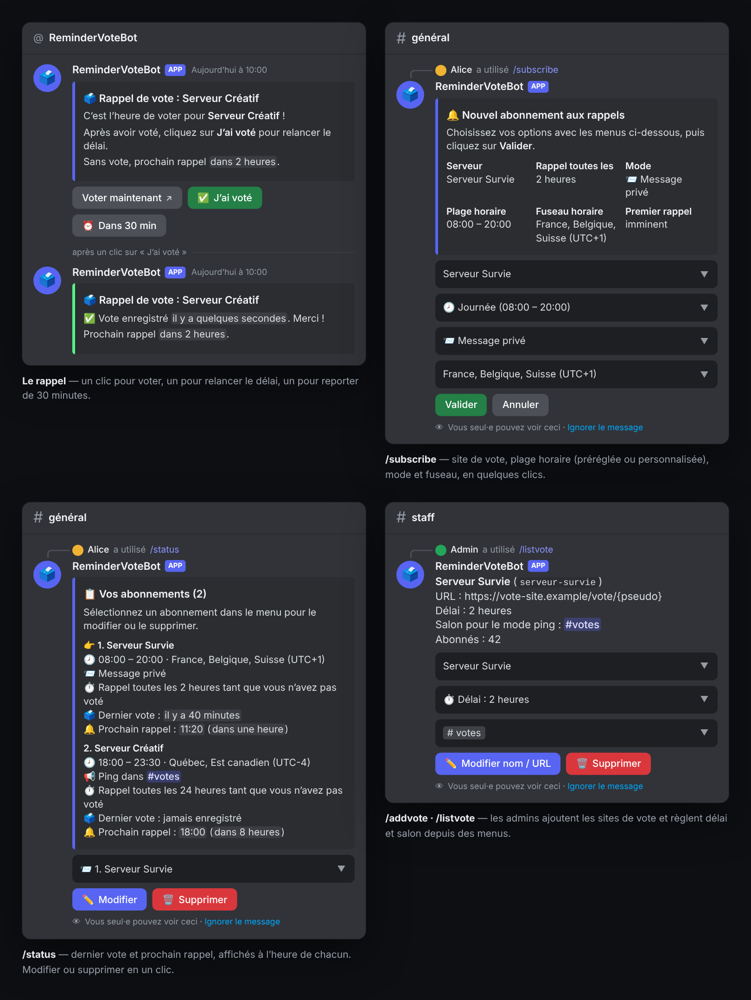

# ReminderVoteBot

[English](README.md) · **Français** · [Site du projet](https://mrddream.github.io/ReminderVoteBot/)

[](https://github.com/MrDDream/ReminderVoteBot/actions/workflows/docker.yml)
[](https://github.com/users/MrDDream/packages/container/package/remindervotebot)
[](LICENSE)

Bot Discord qui rappelle à vos joueurs de voter pour votre serveur, au bon moment : en message privé ou par mention dans un salon, pour chaque site de vote, selon leurs horaires et leur fuseau.



## Fonctionnalités

- 🔔 **Rappels par MP ou mention** dans le salon choisi par l'admin, avec repli automatique en MP
- 🕗 **Plages horaires** : préréglages (journée, matin, soirée…) ou heures précises, plages de nuit comprises
- 🌍 **Fuseau horaire par joueur**
- 🎯 **Plusieurs sites de vote** (25 maximum), chacun avec son délai (1 h à 24 h) et son salon ; le pseudo est inséré dans l'URL
- ✅ **Boutons dans le rappel** : *Voter maintenant*, *J'ai voté* (relance le délai), *Dans 30 min*
- ⚡ **Vote en un clic** (optionnel) : avec un domaine public, *Voter maintenant* enregistre le vote tout seul
- 📋 **`/status`** : dernier vote et prochain rappel, modification et suppression en un clic
- 🛡️ **Fiable** : sauvegarde avec copie de secours, conteneur non-root, commandes admin réservées à « Gérer le serveur »
- 🇫🇷 🇬🇧 Français ou anglais

## Installation

Le bot est distribué en image Docker prête à l'emploi (`linux/amd64` et `linux/arm64`) : il suffit de Docker avec Docker Compose.

### 1. Créer le bot Discord

1. Sur le [Discord Developer Portal](https://discord.com/developers/applications), créez une application.
2. Notez son **Application ID** (onglet *General Information*), puis dans l'onglet *Bot*, générez et notez le **token**.
3. Invitez le bot sur votre serveur avec ce lien, en remplaçant `APPLICATION_ID` :
   ```
   https://discord.com/oauth2/authorize?client_id=APPLICATION_ID&scope=bot%20applications.commands&permissions=19456
   ```
   (permissions : voir les salons, envoyer des messages, intégrer des liens)
4. Récupérez l'**ID de votre serveur** : activez le *Mode développeur* dans les paramètres Discord, puis clic droit sur le serveur → *Copier l'identifiant du serveur*.

### 2. Récupérer le fichier Docker Compose

```bash
mkdir remindervotebot && cd remindervotebot
curl -O https://raw.githubusercontent.com/MrDDream/ReminderVoteBot/main/docker-compose.yml
```

### 3. Créer le fichier `.env` à côté

```env
DISCORD_TOKEN=token_du_bot
CLIENT_ID=application_id
GUILD_ID=id_de_votre_serveur_discord
BOT_LANG=fr
DEFAULT_TZ=Europe/Paris

# Optionnel : vote en un clic (voir plus bas). Décommentez les deux lignes.
# PUBLIC_BASE_URL=https://vote.example.com
# MARK_SECRET=
```

### 4. Démarrer

```bash
docker compose up -d
docker compose logs -f   # pour suivre le démarrage
```

Au démarrage, le bot enregistre ses commandes slash sur votre serveur. Un administrateur ajoute ensuite les sites de vote avec `/addvote`, et les joueurs s'abonnent avec `/subscribe`.

### Mettre à jour

```bash
docker compose pull && docker compose up -d
```

Les abonnements et les sites de vote sont conservés dans le volume Docker `bot_data`.

> **Mise à jour depuis une image antérieure au 27 octobre 2026** : le conteneur ne tourne plus en root. Si le bot refuse de démarrer en signalant des données non modifiables, lancez une seule fois :
> ```bash
> docker compose run --rm --user root bot chown -R node:node /app/data
> ```

### Vote en un clic (optionnel)

Par défaut, *Voter maintenant* ouvre directement le site de vote, et le joueur clique sur *J'ai voté* pour relancer son délai. Pour que le vote soit enregistré automatiquement :

1. Rendez le bot joignable depuis Internet sur un domaine en HTTPS, par exemple avec un reverse proxy (Caddy, Nginx, Traefik…) vers le port `3000` du conteneur.
2. Dans le `.env`, renseignez `PUBLIC_BASE_URL` avec ce domaine et `MARK_SECRET` avec une clé d'au moins 32 caractères (`openssl rand -hex 32`).
3. Relancez : `docker compose up -d`.

Le bouton passe alors par un lien personnel, signé et valable 7 jours, qui enregistre le vote puis redirige vers le site. En mode mention dans un salon, ce lien est envoyé au joueur en privé, pour que les autres membres ne puissent pas voter à sa place.

## Configuration

| Variable | Requis | Description | Par défaut |
|----------|--------|-------------|------------|
| `DISCORD_TOKEN` | Oui | Token du bot | - |
| `CLIENT_ID` | Oui | Application ID du bot | - |
| `GUILD_ID` | Oui | ID du serveur Discord du bot : les commandes n'existent que là, et les commandes admin ne fonctionnent que là | - |
| `BOT_LANG` | Non | Langue du bot : `fr` ou `en` | `fr` |
| `DEFAULT_TZ` | Non | Fuseau proposé par défaut aux joueurs (ex. `Europe/Paris`, `America/Toronto`) | `Europe/Paris` |
| `PUBLIC_BASE_URL` | Non | Domaine public du bot, pour le vote en un clic | - |
| `MARK_SECRET` | Avec `PUBLIC_BASE_URL` | Clé de signature des liens de vote, 32 caractères minimum | - |
| `PORT` | Non | Port du serveur HTTP du bot | `3000` |

Le bot vérifie sa configuration au démarrage et s'arrête avec un message explicite si quelque chose manque ou est invalide.

## Utilisation

### Commandes des joueurs

| Commande | Rôle |
|----------|------|
| `/subscribe` | S'abonner aux rappels d'un site de vote : plage horaire (préréglée ou personnalisée, ex. `9h`–`21:30`), mode (MP ou mention dans le salon du site) et fuseau horaire. Le formulaire indique quand partira le premier rappel. |
| `/status` | Voir ses abonnements (dernier vote, prochain rappel), les modifier, les supprimer, ou réactiver un abonnement mis en pause. |
| `/unsubscribe` | Se désabonner d'un site ou de tous. |

Chaque rappel propose trois boutons :
- **Voter maintenant** : ouvre la page de vote, et enregistre le vote si le vote en un clic est activé
- **✅ J'ai voté** : enregistre le vote et relance le délai ; le message est mis à jour
- **⏰ Dans 30 min** : reporte le rappel de 30 minutes

### Commandes des administrateurs

Elles demandent la permission « Gérer le serveur » sur le serveur `GUILD_ID`.

| Commande | Rôle |
|----------|------|
| `/addvote [delai] [salon]` | Ajouter un site de vote : délai entre deux votes (1 h, 2 h, 3 h, 4 h, 12 h ou 24 h ; 2 h par défaut), salon pour le mode mention (optionnel), puis nom et URL dans un formulaire. |
| `/listvote` | Gérer les sites : nombre d'abonnés, délai et salon modifiables par menus, nom et URL, suppression (les abonnements au site sont supprimés aussi). |

**URL de vote** : en `https://`, 400 caractères maximum. Placez `{pseudo}` à l'endroit où doit aller le pseudo du joueur (ex. `https://site-de-vote.example/vote/{pseudo}`) ; sans `{pseudo}`, `?pseudo=<pseudo>` est ajouté à l'URL. Le pseudo utilisé est le surnom du joueur sur votre serveur.

## Fonctionnement

1. Chaque minute, le bot vérifie si un rappel est dû pour chaque abonnement.
2. Un rappel part quand le délai du site est écoulé depuis le dernier vote ou le dernier rappel, et que le joueur est dans sa plage horaire (dans son fuseau). S'il devient dû en dehors de la plage, il part à son ouverture.
3. Tant que le joueur ne vote pas, le rappel est relancé à chaque délai.
4. Le vote est enregistré par *J'ai voté*, ou automatiquement avec le vote en un clic. Le délai repart de ce moment.
5. Si la mention dans le salon échoue (salon supprimé, permissions…), le rappel est envoyé en MP. Après 3 échecs d'envoi consécutifs (MP fermés par exemple), l'abonnement est mis en pause et `/status` propose de le réactiver.

## Données et sauvegarde

Les données sont dans le volume `bot_data` (`/app/data` dans le conteneur) :
- `config.json` : sites de vote et réglages
- `subscriptions.json` : abonnements

Chaque écriture est atomique, et la version précédente est gardée en `.bak`. Si un fichier est corrompu, le bot le restaure depuis la copie ; sinon, il refuse de démarrer plutôt que d'écraser vos données.

Pour faire une sauvegarde :

```bash
docker compose cp bot:/app/data ./sauvegarde-data
```

## Dépannage

| Problème | Que vérifier |
|----------|--------------|
| Le conteneur s'arrête au démarrage | `docker compose logs bot` : le message indique la variable manquante ou invalide, ou la commande `chown` à lancer. |
| Les commandes n'apparaissent pas | `GUILD_ID` est bien l'ID de votre serveur, et le bot y a été invité avec le scope `applications.commands`. Redémarrez le conteneur : les commandes sont enregistrées à chaque démarrage. |
| `/addvote` ou `/listvote` refusé | Il faut la permission « Gérer le serveur » sur le serveur `GUILD_ID`. |
| Pas de rappel | `/status` affiche le prochain rappel. Vérifiez la plage horaire et le fuseau, et que le joueur accepte les MP des membres du serveur. Un abonnement en pause se réactive depuis `/status`. |
| Le vote en un clic ne marche pas | `PUBLIC_BASE_URL` doit pointer vers le bot en HTTPS (`https://votre-domaine/health` doit répondre `{"ok":true}`). |

## Licence

Projet sous licence MIT, voir [LICENSE](LICENSE).

## Contribution et support

Les contributions sont les bienvenues : ouvrez une issue ou une pull request sur GitHub.

---

Fait avec ❤️ par MrDDream
