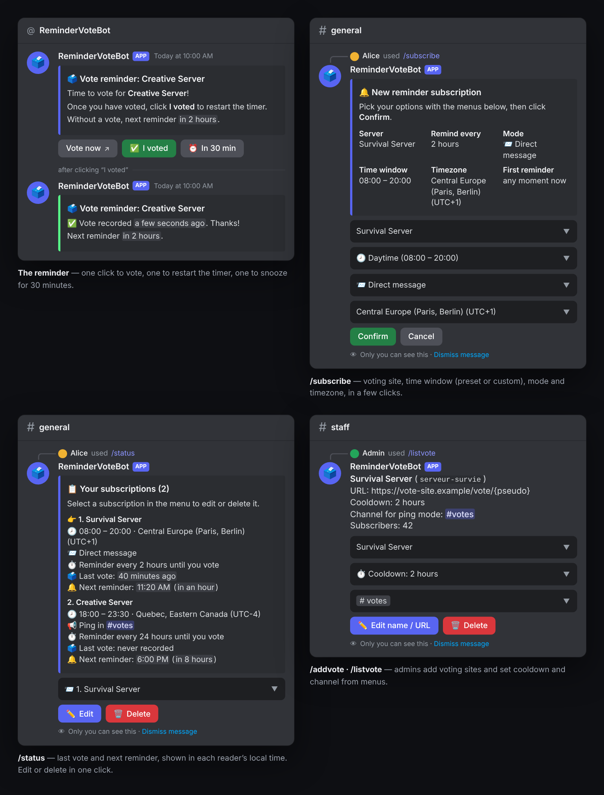

# ReminderVoteBot

**English** · [Français](README.fr.md) · [Project website](https://mrddream.github.io/ReminderVoteBot/)

[](https://github.com/MrDDream/ReminderVoteBot/actions/workflows/docker.yml)
[](https://github.com/users/MrDDream/packages/container/package/remindervotebot)
[](LICENSE)

A Discord bot that reminds your players to vote for your server at the right time: by direct message or channel mention, for each voting site, following their own hours and timezone.



## Features

- 🔔 **Reminders by DM or mention** in the channel picked by the admin, with automatic fallback to DM
- 🕗 **Time windows**: presets (daytime, morning, evening…) or exact hours, overnight windows included
- 🌍 **Per-player timezone**
- 🎯 **Several voting sites** (up to 25), each with its own cooldown (1 h to 24 h) and channel; the username is inserted in the URL
- ✅ **Buttons in the reminder**: *Vote now*, *I voted* (restarts the timer), *In 30 min*
- ⚡ **One-click voting** (optional): with a public domain, *Vote now* records the vote by itself
- 📋 **`/status`**: last vote and next reminder, edit or delete in one click
- 🛡️ **Reliable**: saves with a backup copy, non-root container, admin commands restricted to “Manage Server”
- 🇬🇧 🇫🇷 English or French

## Installation

The bot ships as a ready-to-use Docker image (`linux/amd64` and `linux/arm64`): all you need is Docker with Docker Compose.

### 1. Create the Discord bot

1. On the [Discord Developer Portal](https://discord.com/developers/applications), create an application.
2. Copy its **Application ID** (*General Information* tab), then in the *Bot* tab, generate and copy the **token**.
3. Invite the bot to your server with this link, replacing `APPLICATION_ID`:
   ```
   https://discord.com/oauth2/authorize?client_id=APPLICATION_ID&scope=bot%20applications.commands&permissions=19456
   ```
   (permissions: view channels, send messages, embed links)
4. Get your **server ID**: enable *Developer Mode* in Discord settings, then right-click the server → *Copy Server ID*.

### 2. Get the Docker Compose file

```bash
mkdir remindervotebot && cd remindervotebot
curl -O https://raw.githubusercontent.com/MrDDream/ReminderVoteBot/main/docker-compose.yml
```

### 3. Create the `.env` file next to it

```env
DISCORD_TOKEN=bot_token
CLIENT_ID=application_id
GUILD_ID=your_discord_server_id
BOT_LANG=en
DEFAULT_TZ=Europe/London

# Optional: one-click voting (see below). Uncomment both lines.
# PUBLIC_BASE_URL=https://vote.example.com
# MARK_SECRET=
```

### 4. Start

```bash
docker compose up -d
docker compose logs -f   # to follow the startup
```

On startup, the bot registers its slash commands on your server. An administrator then adds the voting sites with `/addvote`, and players subscribe with `/subscribe`.

### Update

```bash
docker compose pull && docker compose up -d
```

Subscriptions and voting sites are kept in the `bot_data` Docker volume.

> **Updating from an image older than October 27, 2026**: the container no longer runs as root. If the bot refuses to start and reports data it cannot write, run once:
> ```bash
> docker compose run --rm --user root bot chown -R node:node /app/data
> ```

### One-click voting (optional)

By default, *Vote now* opens the voting site directly, and the player clicks *I voted* to restart their timer. To record the vote automatically:

1. Make the bot reachable from the Internet on an HTTPS domain, for example with a reverse proxy (Caddy, Nginx, Traefik…) to port `3000` of the container.
2. In `.env`, set `PUBLIC_BASE_URL` to that domain and `MARK_SECRET` to a key of at least 32 characters (`openssl rand -hex 32`).
3. Restart: `docker compose up -d`.

The button then goes through a personal link, signed and valid for 7 days, that records the vote and redirects to the site. In channel mention mode, this link is sent to the player privately, so other members cannot vote in their place.

## Configuration

| Variable | Required | Description | Default |
|----------|----------|-------------|---------|
| `DISCORD_TOKEN` | Yes | Bot token | - |
| `CLIENT_ID` | Yes | Bot Application ID | - |
| `GUILD_ID` | Yes | ID of the bot's Discord server: commands only exist there, and admin commands only work there | - |
| `BOT_LANG` | No | Bot language: `en` or `fr` | `fr` |
| `DEFAULT_TZ` | No | Timezone offered to players by default (e.g. `Europe/London`, `America/New_York`) | `Europe/Paris` |
| `PUBLIC_BASE_URL` | No | Public domain of the bot, for one-click voting | - |
| `MARK_SECRET` | With `PUBLIC_BASE_URL` | Signing key for vote links, 32 characters minimum | - |
| `PORT` | No | Port of the bot's HTTP server | `3000` |

The bot checks its configuration on startup and stops with an explicit message if something is missing or invalid.

## Usage

### Player commands

| Command | Purpose |
|---------|---------|
| `/subscribe` | Subscribe to a voting site's reminders: time window (preset or custom, e.g. `9h`–`21:30`), mode (DM or mention in the site's channel) and timezone. The form shows when the first reminder will be sent. |
| `/status` | See your subscriptions (last vote, next reminder), edit or delete them, or resume a paused subscription. |
| `/unsubscribe` | Unsubscribe from one site or all of them. |

Each reminder has three buttons:
- **Vote now**: opens the voting page, and records the vote when one-click voting is enabled
- **✅ I voted**: records the vote and restarts the timer; the message is updated
- **⏰ In 30 min**: snoozes the reminder for 30 minutes

### Administrator commands

They require the “Manage Server” permission on the `GUILD_ID` server.

| Command | Purpose |
|---------|---------|
| `/addvote [cooldown] [channel]` | Add a voting site: cooldown between two votes (1 h, 2 h, 3 h, 4 h, 12 h or 24 h; 2 h by default), channel for mention mode (optional), then name and URL in a form. |
| `/listvote` | Manage sites: subscriber count, cooldown and channel changed from menus, name and URL, deletion (subscriptions to the site are deleted too). |

**Vote URL**: `https://`, 400 characters max. Put `{pseudo}` where the player's name must go (e.g. `https://voting-site.example/vote/{pseudo}`); without `{pseudo}`, `?pseudo=<name>` is appended to the URL. The name used is the player's nickname on your server.

## How it works

1. Every minute, the bot checks whether a reminder is due for each subscription.
2. A reminder is sent when the site's cooldown has elapsed since the last vote or the last reminder, and the player is inside their time window (in their timezone). If it becomes due outside the window, it is sent when the window opens.
3. As long as the player does not vote, the reminder is repeated every cooldown.
4. The vote is recorded by *I voted*, or automatically with one-click voting. The cooldown restarts from that moment.
5. If the channel mention fails (channel deleted, permissions…), the reminder is sent by DM. After 3 consecutive failed deliveries (closed DMs for example), the subscription is paused and `/status` offers to resume it.

## Data and backups

Data lives in the `bot_data` volume (`/app/data` in the container):
- `config.json`: voting sites and settings
- `subscriptions.json`: subscriptions

Every write is atomic, and the previous version is kept as `.bak`. If a file is corrupted, the bot restores it from the copy; otherwise it refuses to start rather than overwrite your data.

To make a backup:

```bash
docker compose cp bot:/app/data ./data-backup
```

## Troubleshooting

| Problem | What to check |
|---------|---------------|
| The container stops on startup | `docker compose logs bot`: the message names the missing or invalid variable, or the `chown` command to run. |
| Commands do not show up | `GUILD_ID` is your server's ID, and the bot was invited with the `applications.commands` scope. Restart the container: commands are registered on every start. |
| `/addvote` or `/listvote` refused | You need the “Manage Server” permission on the `GUILD_ID` server. |
| No reminder | `/status` shows the next reminder. Check the time window and timezone, and that the player accepts DMs from server members. A paused subscription is resumed from `/status`. |
| One-click voting does not work | `PUBLIC_BASE_URL` must point to the bot over HTTPS (`https://your-domain/health` must answer `{"ok":true}`). |

## License

MIT licensed, see [LICENSE](LICENSE).

## Contributing and support

Contributions are welcome: open an issue or a pull request on GitHub.

---

Made with ❤️ by MrDDream
